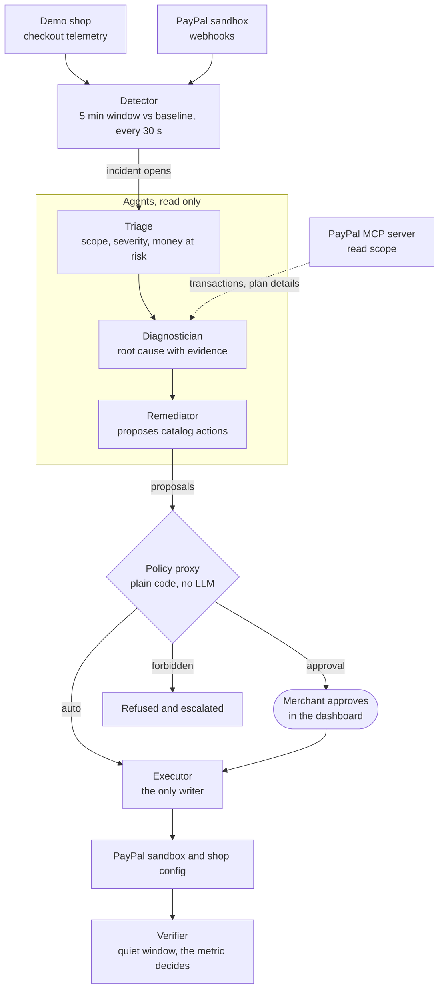
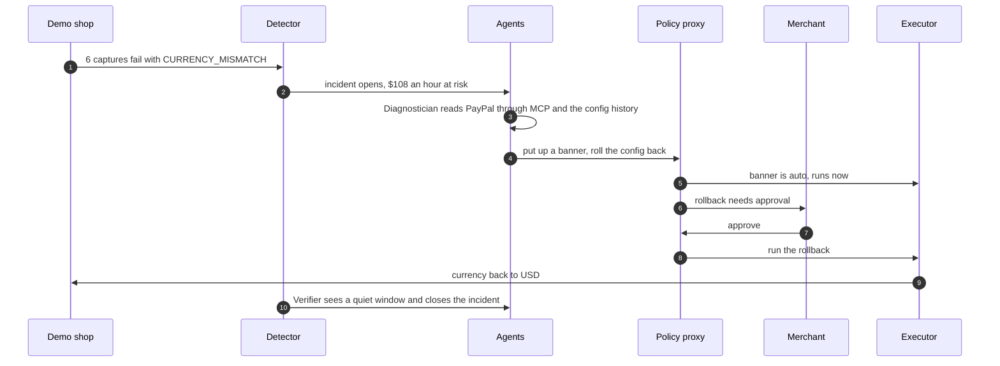

# Flatline

**On call for your revenue.**

[](docs/media/flatline_demo.mp4)

Every online shop monitors its servers. Almost nobody monitors their money. When checkout breaks on a Friday evening, or refunds suddenly pile up on one product, most merchants find out days later from a payout report or an annoyed customer.

I built Flatline to close that gap. It is an SRE agent that sits on call for a merchant's PayPal integration. It notices checkout failures, refund waves and failing subscription renewals within seconds, works out the root cause from real evidence, and fixes what it is allowed to fix. The part I care about most is how it fixes things: every action goes through a policy proxy written in plain code, not a prompt, and the agents never hold write credentials. Anything that moves money waits for a person.

Built for the PayPal AI Hackathon. MIT licensed. Copyright 2026 Abdul Musawar Soomro.

**Jump to:** [the demo](#the-demo) · [the approach](#the-approach) · [how it works](#how-it-works) · [one incident, start to finish](#one-incident-start-to-finish) · [run it](#run-it) · [why you can trust it](#why-you-can-trust-it)

## The demo

The GIF above is a short cut. The full walkthrough with narration runs two and a half minutes: [docs/media/flatline_demo.mp4](docs/media/flatline_demo.mp4). Everything in it was recorded against the running stack on the PayPal sandbox with live models, and every root cause, proposal and rationale you see on screen was written by the model named in that agent step.

It shows three incidents:

1. **A broken checkout.** A config change switches a US shop to euros and captures start failing. Flatline puts up a warning banner on its own, finds the config change, and waits for me to approve the rollback.
2. **A refund wave.** Five refunds in an hour on one coffee, from five different buyers. Flatline traces it to the product and proposes pausing its sales. A forbidden bulk refund, slipped in as a red team probe, is refused by the proxy.
3. **Failing renewals.** Four Coffee Club renewals fail. Flatline reads the plan from PayPal, sees the plan is healthy and the subscribers' payments are the problem, and sends reminders on its own.

## The approach

A few decisions shaped everything else.

**Detect from what PayPal pushes, not from reports.** PayPal Transaction Search can lag by up to three hours, which is useless as a clock for alerts. Flatline detects from webhooks and the shop's own checkout telemetry, and uses Transaction Search only as evidence once an incident is open.

**Let the models reason, but only over evidence.** The agents see the events of their own incident, the config history, the runbook for that playbook and what they read from PayPal through MCP. Every claim in a diagnosis has to cite where it came from. They never see a prepared answer, and they are not told which events the Chaos panel injected. They have to work it out from the data, like in any fault injection test.

**Agents can ask. Code decides.** The agents only propose. A policy proxy looks each proposal up in a catalog and gives it one of three tiers. Nothing an agent writes can change the tier, and anything not in the catalog is refused.

| Tier | Examples | What happens |
| --- | --- | --- |
| auto | shop banner, alert, report, payment reminder | Runs straight away and is logged |
| approval | config rollback, pause product sales, capture an outstanding balance, a single refund up to the limit | Waits in the dashboard for a person |
| forbidden | bulk refunds, cancelling a subscription, accepting a dispute, payouts, anything unknown | Refused, and the incident is escalated |

**The metric decides when it is over.** After a fix, the Verifier waits for a quiet window. Whether the incident is resolved comes from the numbers. The model only writes the explanation.

**Be honest about the test harness.** Injected events carry a simulated badge in the transactions grid. Injected incidents use made up PayPal ids, so their PayPal writes are recorded as simulated rather than sent. The red team probe is labelled as a probe.

**Run on free or local models.** Each agent calls a model through LiteLLM with a fallback chain, so a rate limit on the Gemini free tier moves on to the next model, and finally to a Qwen running locally through Ollama. Every step in the timeline names the model that answered it. If every model fails, the step keeps the playbook's deterministic answer and says so.

## How it works




The detector runs every 30 seconds and compares a five minute window with a rolling baseline. Three playbooks ship enabled:

* **Checkout failure spike** fires when capture failures in a five minute window reach three times the baseline.
* **Refund wave** fires when refunds jump far above baseline or more than half of them share one product.
* **Subscription renewal failures** fire when failed renewals cluster on one plan within an hour.

Thresholds live in `flatline/playbooks/*.yaml`, along with each playbook's runbook (typical causes and usual fixes) and the actions it may propose. The expected outcome for each one is in [docs/playbooks.md](docs/playbooks.md).

### Where the AI is, and where it is not

| Part | What decides | How |
| --- | --- | --- |
| Detector | Code | Playbook thresholds against a rolling baseline, every 30 seconds |
| Triage | LLM (`MODEL_FAST`) | Severity, scope and money at risk, from the incident and its events |
| Diagnostician | LLM (`MODEL_REASONING`) | Root cause from events, config history and PayPal reads through MCP; every claim cites evidence |
| Remediator | LLM (`MODEL_REASONING`) | Proposes fixes, limited to the playbook's allowed actions and their parameters |
| Policy proxy | Code | Catalog lookup: auto, approval or forbidden. No LLM involved |
| Executor | Code | The only writer to PayPal and the shop |
| Verifier | Code, then LLM | The metric decides whether it recovered; the LLM only writes the explanation |

There is more detail in [docs/architecture.md](docs/architecture.md), and the reasoning behind the bigger choices is in [docs/decisions.md](docs/decisions.md).

## One incident, start to finish

This is the checkout scenario from the video, frame by frame.



**1. Break something.** The Chaos panel is there for judges. *Ship bad currency config* writes a new config version that sets EUR on a USD shop and injects the failing captures, all labelled as synthetic.


**2. The shop is broken.** The checkout now charges euros on a US shop, so captures fail. By the time you look, the agents have already put up a warning banner, because a banner is an auto action.


**3. The incident opens within seconds,** with the money at risk per hour.


**4. The agents work it.** Each step in the timeline names the model that answered and how long it took. The Diagnostician reads recent transactions from PayPal through the MCP server. This run was answered by the local Qwen, because the free Gemini quota was used up for the day.


**5. The root cause, with evidence.** It matched the CURRENCY_MISMATCH errors to the config version that set EUR, and cites both.


**6. One click.** The rollback waited for me. After I approve it, the executor runs it and the card shows it as executed.


### The other two incidents

In the refund wave the agents trace five refunds from five different buyers to one product and propose pausing its sales, which needs approval. Next to it sits the red team probe: a bulk refund the playbook adds on purpose to prove the proxy refuses it.


For the failing renewals the Diagnostician reads the Coffee Club plan from PayPal, finds it active and healthy, and concludes it is the subscribers' payments that fail. Payment reminders are an auto action, so they go out on their own.


## Run it

You need Python 3.12 and Docker. Node 20 is only needed for the PayPal MCP server when you use the sandbox (the Docker image already has it).

### 1. Without any keys

Everything runs in mock mode by default, with deterministic stand ins for PayPal and the models. This is the quickest way to see that it works.

```bash
git clone https://github.com/mazzyy/Flatline.git
cd Flatline
cp .env.example .env
python3 -m venv .venv && source .venv/bin/activate
pip install -r requirements-dev.txt
make test        # unit and integration tests, no network, no keys
make demo-test   # all three scenarios end to end, in process
```

### 2. The whole stack with Docker

```bash
cp .env.example .env   # if you have not already
make up
```

| What | Where |
| --- | --- |
| Dashboard and API | http://localhost:8000 (passcode `demo-judge`) |
| Demo shop | http://localhost:3000 |

`make up` seeds ten minutes of normal traffic. Run `make down` when you are done.

### 3. Break something

Use the Chaos panel in the dashboard, or the command line:

```bash
python scripts/inject.py checkout_failure_spike
python scripts/inject.py refund_wave
python scripts/inject.py subscription_renewal_failures
```

The API writes the injected events and runs the detector straight away, so the incident opens within seconds and the agents start on it. **Reset all chaos** in the panel puts the shop back to normal. A new incident for the same playbook within 30 minutes is merged into the open one, so wait a little before repeating a scenario.

### 4. Connect the PayPal sandbox and live models

Only needed if you want real sandbox traffic and real models instead of the mock.

1. Create a REST app on [PayPal Developer](https://developer.paypal.com/) in sandbox mode. Copy the Client ID and Secret into `.env` and set `PAYPAL_ENVIRONMENT=SANDBOX`.
2. Turn on Transaction Search for the app. Flatline only uses it as evidence.
3. Register a webhook pointing at `https://<your-api>/webhooks/paypal` for the event types listed in section 9.2 of the [spec](docs/spec.md), and put its ID in `PAYPAL_WEBHOOK_ID`.
4. Run `python scripts/sandbox_setup.py`. It creates the Coffee Club product and its monthly plan and prints `PAYPAL_SANDBOX_PRODUCT_ID` and `PAYPAL_SANDBOX_PLAN_ID` for `.env`.
5. Pick your models and set `LLM_MODE=live`:

    ```bash
    # Gemini on the free tier
    MODEL_FAST=gemini/gemini-2.5-flash-lite
    MODEL_REASONING=gemini/gemini-2.5-flash
    GEMINI_API_KEY=...
    # optional: try these when a model is rate limited, ending with a local one
    MODEL_FALLBACKS=gemini/gemini-3.1-flash-lite,ollama_chat/qwen2.5:7b
    OLLAMA_API_BASE=http://localhost:11434
    ```

    Any provider LiteLLM supports works the same way. For everything on premises, point both models at `ollama_chat/<model>`. Azure OpenAI uses `azure/<deployment>` with the `AZURE_*` values.
6. Install the extras and check the connections:

    ```bash
    pip install -r requirements-live.txt
    python scripts/llm_check.py   # each model answers
    python scripts/mcp_check.py   # PayPal MCP read and write sessions, one Transaction Search
    ```

7. Run `make up` again. The demo shop reads the same client ID from `.env`, so its checkout shows the PayPal JS SDK v6 button.

`PAYPAL_ENVIRONMENT` has to be `MOCK` or `SANDBOX`. With any other value the services refuse to start. There is no live PayPal path, on purpose.

### 5. Check everything end to end

```bash
python scripts/live_check.py
```

It presses the same Chaos buttons as the dashboard, waits for the agents, and prints every step with its model, latency and PayPal reads. It checks that each diagnosis names the right cause, that the rollback and the pause wait for approval, that the bulk refund is refused and that the reminder runs on its own. A run that ends in `PASS` is how the demo video was recorded.

### Deploy to Render (optional)

The repo includes a [Blueprint](render.yaml) that fits Render's free instances: one web service runs the API, the detector and the agent loop together (`RUN_WORKERS=true`), a second one runs the demo shop, and a free Postgres holds the data.

1. In Render, create a new Blueprint and pick this repo.
2. Fill in the variables marked `sync: false`: the PayPal sandbox credentials, the webhook ID, the plan and product IDs, `GEMINI_API_KEY`, `MODEL_FAST`, `MODEL_REASONING`, `DASHBOARD_PASSCODE`, `INJECT_TOKEN`, `APP_BASE_URL`, and `FLATLINE_API_URL` for the shop.
3. Leave `PAYPAL_ENVIRONMENT` at `SANDBOX`.
4. Check it with `python scripts/live_check.py --url https://<your-api>.onrender.com`.

Free services sleep after 15 minutes without traffic, so the first request takes about a minute. Render deletes a free database 30 days after it is created.

## Why you can trust it


1. **No live PayPal.** A startup guard checks the environment, and there is no live host anywhere in the code.
2. **Agents are read only.** They get a `ReadOnlyGateway` whose write methods raise, and an import boundary test keeps agent code away from the writer.
3. **Unknown actions are forbidden.** The allowlist lives in `flatline/policy/catalog.py`.
4. **Writes happen only after the policy says yes.** `flatline/policy/executor.py` is the only module that writes to PayPal or the shop.
5. **Everything is audited.** Every detection, agent step, decision, approval and execution lands in the audit log and streams to the dashboard live.

## What is in the repo

| Folder | What lives there |
| --- | --- |
| `flatline/ingest` | FastAPI app: webhooks, telemetry, dashboard API, live updates, Chaos endpoints |
| `flatline/detector` | Windows, baselines and incident creation |
| `flatline/agents` | The four agents, their prompts and the read only tools they get |
| `flatline/policy` | Action catalog, policy proxy and the executor |
| `flatline/paypal` | Sandbox and mock gateways, the MCP client |
| `flatline/playbooks` | Thresholds, runbooks and allowed actions per playbook |
| `dashboard` | React dashboard: overview, incidents, transactions grid, policy, audit, Chaos panel |
| `demo-shop` | Lumen Coffee Co., a small Node shop with the PayPal JS SDK v6 |
| `scripts` | Seeding, injection, sandbox setup and the live checks |
| `demo-video` | The demo video, made in code with Remotion, with its narration and soundtrack scripts |
| `docs` | Architecture, decisions, playbooks, spec and the Devpost write up |

## Built with

Python 3.12, FastAPI, SQLAlchemy 2, Alembic, PostgreSQL 16, LiteLLM (Gemini, a local Qwen through Ollama, or Azure OpenAI), the official `@paypal/mcp` server, PayPal REST APIs and webhooks, the PayPal JS SDK v6, React, Vite, TypeScript, AG Grid Community, Docker and Render.

The demo video is made with Remotion. the music and sound effects are synthesized in code, so there is nothing licensed in it.

## License

MIT. See [LICENSE](LICENSE).
