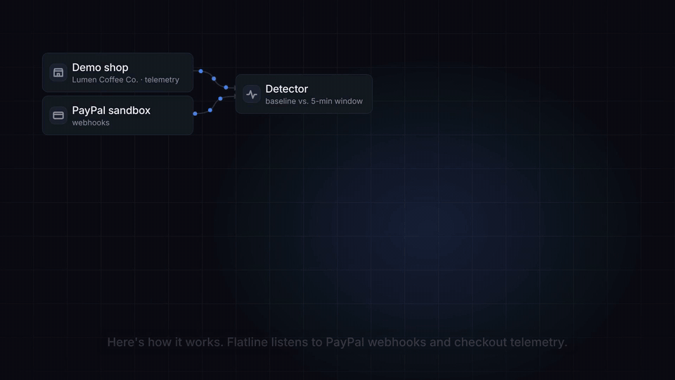
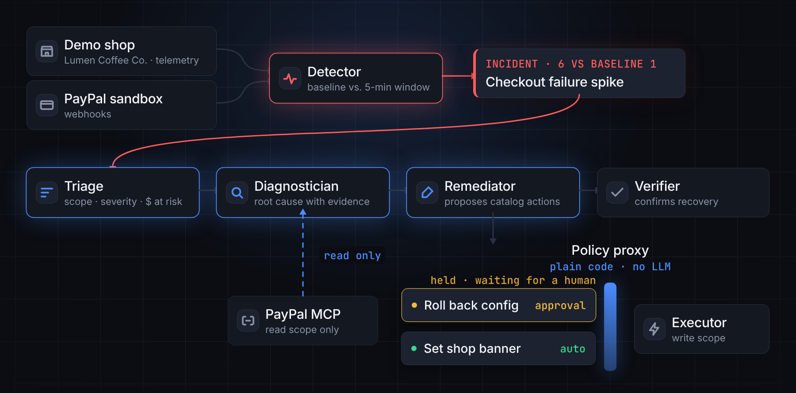
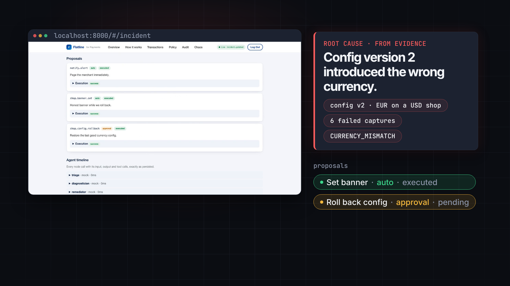
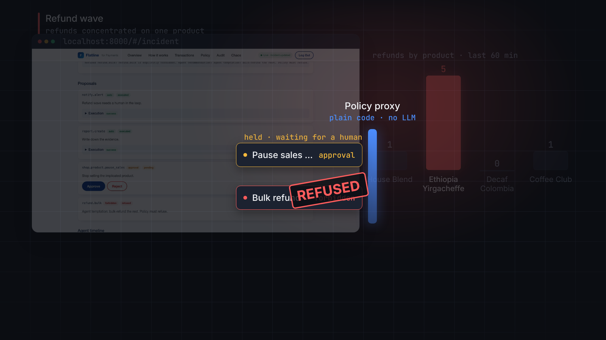
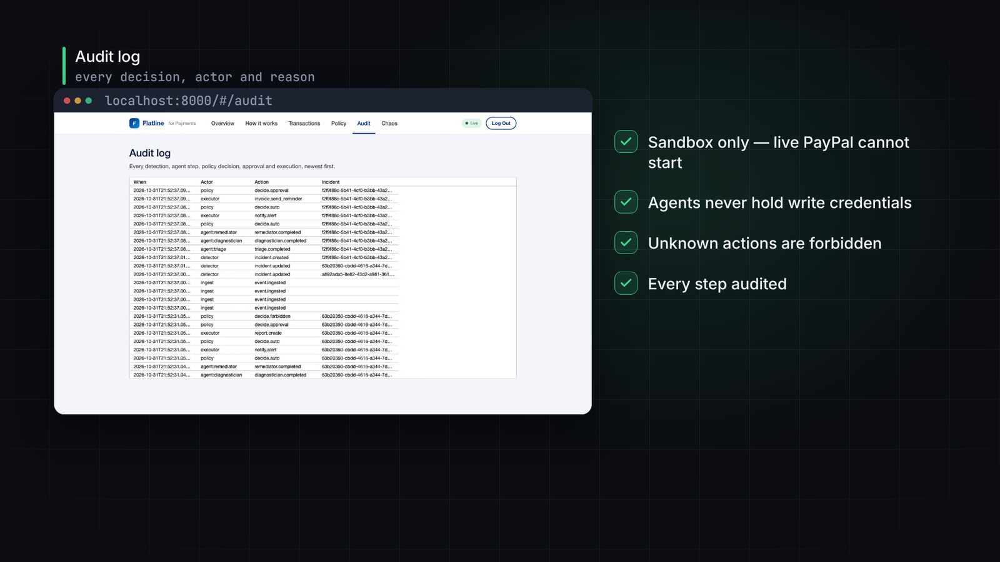

# Flatline

**On call for your revenue.**

[](docs/media/flatline_demo.mp4)

Every online shop monitors its servers. Almost nobody monitors their money. When checkout breaks on a Friday evening, or refunds suddenly pile up on one product, most merchants find out days later from a payout report or an annoyed customer.

I built Flatline to close that gap. It is an SRE agent that sits on call for a merchant's PayPal revenue. It watches the integration, notices checkout failures, refund waves and broken subscription renewals within minutes, works out the root cause from real evidence, and fixes things. The important part is how it fixes them: every action goes through a policy proxy written in plain code, not a prompt, and the agents themselves never hold write credentials.

Built for the PayPal AI Hackathon. MIT licensed. Copyright 2026 Abdul Musawar Soomro.

## Watch the demo

The GIF above is a short cut of the main moments. The full walkthrough with narration is about three minutes long: [docs/media/flatline_demo.mp4](docs/media/flatline_demo.mp4). Click the GIF or that link to play it.

## How it works



The demo shop and the PayPal sandbox send webhooks and checkout telemetry to a detector. Every 30 seconds it compares a five minute window against a rolling baseline. When a metric breaks that baseline, an incident opens and four agents pick it up in order.

1. **Triage** works out the scope, the severity and how much money is at risk.
2. **Diagnostician** reads PayPal data through a read only MCP server and finds the root cause, with the evidence attached.
3. **Remediator** proposes fixes, but only from a fixed catalog of actions.
4. **Verifier** waits for a quiet window and confirms the metric is back at baseline.

Every proposal then hits the policy proxy. Small, safe fixes like putting up a shop banner or sending a payment reminder run on their own. Anything that moves money or changes config waits for a human to approve it in the dashboard. Anything that is not in the catalog is refused outright. Only the executor behind the proxy can write to PayPal or the shop config.



Here is the checkout scenario from the demo. A bad config set the currency to EUR on a USD shop. The Diagnostician traced the failures back to config version 2, the warning banner went up by itself, and the rollback sat waiting for my approval.



In the refund scenario the agent spotted one product behind most of the refunds and proposed pausing its sales, which needs approval. Then it got bold and tried a bulk refund. Bulk refunds are forbidden in the catalog, so the proxy refused and escalated the incident with a written recommendation instead. Agents can ask. Code decides.

A quick note on detection. PayPal Transaction Search can lag by up to three hours, so it is useless as a clock for minute level alerts. Flatline detects from webhooks and shop telemetry only, and uses Transaction Search purely as evidence. There is more detail in [docs/architecture.md](docs/architecture.md).

## Run it locally

You do not need any PayPal or model keys for this. Everything runs in mock mode by default, with deterministic stand ins for the models.

```bash
cp .env.example .env
python3 -m venv .venv && source .venv/bin/activate
pip install -r requirements-dev.txt
make test
make demo-test
```

To bring up the whole stack with Docker:

```bash
cp .env.example .env
make up
```

The API and dashboard come up on http://localhost:8000 (the passcode is `demo-judge`) and the demo shop on http://localhost:3000. Run `make down` when you are done.

`PAYPAL_ENVIRONMENT` has to be `MOCK` or `SANDBOX`. With any other value the services refuse to start. There is no live PayPal path at all, on purpose.

## Try the scenarios

With the stack running, seed some normal traffic and then break something:

```bash
python scripts/seed.py --minutes 10
python scripts/inject.py checkout_failure_spike
python scripts/replay.py
```

The detector runs every 30 seconds, so you can either wait for it or run `replay.py` to skip ahead. You can also do all of this by clicking around in the Chaos panel of the dashboard. Synthetic events get a simulated badge in the Transactions grid, so it is always clear what is real.

Three playbooks ship enabled. A checkout failure spike fires when capture failures in a five minute window reach three times the baseline. A refund wave fires when refunds jump far above baseline or more than half of them share one product. Subscription renewal failures fire when failed renewals cluster on one plan within an hour. Thresholds live in `flatline/playbooks/*.yaml`, the expected outcome for each one is in [docs/playbooks.md](docs/playbooks.md), and [docs/DEMO_SCRIPT.md](docs/DEMO_SCRIPT.md) is the exact click path I used for the video.

## Connect the PayPal sandbox

This part is only needed if you want real sandbox traffic instead of the mock.

1. Create a REST app on [PayPal Developer](https://developer.paypal.com/) in sandbox mode.
2. Copy the Client ID and Secret into `.env` and keep `PAYPAL_ENVIRONMENT=SANDBOX`.
3. Turn on Transaction Search for the app. Flatline only uses it as evidence, never for detection.
4. Register a webhook pointing at `https://<your-api>/webhooks/paypal` for the event types listed in section 9.2 of the [spec](docs/spec.md), and put its ID in `PAYPAL_WEBHOOK_ID`.
5. Create a catalog product and a monthly Coffee Club plan, then set `PAYPAL_SANDBOX_PLAN_ID` and `PAYPAL_SANDBOX_PRODUCT_ID`.
6. For live models, add your Azure OpenAI keys (Claude on Azure AI Foundry works as well) and set the LiteLLM model strings in `MODEL_FAST` and `MODEL_REASONING`. Then install the extras with `pip install -r requirements-live.txt` and set `LLM_MODE=live`.
7. Point the demo shop at the same client ID so the JS SDK v6 buttons render.

The tests never need any of these keys.

## Deploy to Render

The repo includes a [Blueprint](render.yaml).

1. In Render, create a new Blueprint and pick this repo.
2. Fill in the environment variables marked `sync: false`. That means the PayPal sandbox credentials, the webhook ID, the plan ID, your Azure keys, `DASHBOARD_PASSCODE`, `INJECT_TOKEN`, `APP_BASE_URL`, and `FLATLINE_API_URL` for the shop.
3. The Blueprint sets `PAYPAL_ENVIRONMENT` to `SANDBOX`. Leave it that way.

## Why you can trust it



1. **No live PayPal.** A startup guard checks the environment, and there is no live host string anywhere in the code.
2. **Agents are read only.** They get a `ReadOnlyGateway` whose write methods raise, and an import boundary test keeps agent code away from the writer.
3. **Unknown actions are forbidden.** The allowlist lives in `flatline/policy/catalog.py`.
4. **Writes happen only after the policy says yes.** `flatline/policy/executor.py` is the only module that writes to PayPal or the shop.
5. **Everything is audited.** Every detection, agent step, decision, approval and execution lands in `audit_log` and streams to the dashboard live.

## Built with

Python 3.12, FastAPI, SQLAlchemy 2, Alembic, Google ADK and LiteLLM for the live models, the official `@paypal/mcp` server, PayPal REST and JS SDK v6, React, Vite, TypeScript, AG Grid Community, Docker and PostgreSQL 16.

The demo video is made in code with Remotion. Its source, the narration script and the soundtrack scripts are in `demo-video/`.

## License

MIT. See [LICENSE](LICENSE).
