# Flatline

**On call for your revenue.**

**Watch the film (2:41):** [youtube.com/watch?v=mnbAXQDoEko](https://www.youtube.com/watch?v=mnbAXQDoEko)

**Try it live:** [flatline-demo-27612c3a852c.herokuapp.com](https://flatline-demo-27612c3a852c.herokuapp.com) · passcode `demo-judge` · demo shop at [/shop](https://flatline-demo-27612c3a852c.herokuapp.com/shop) · PayPal sandbox only, no real money anywhere.

[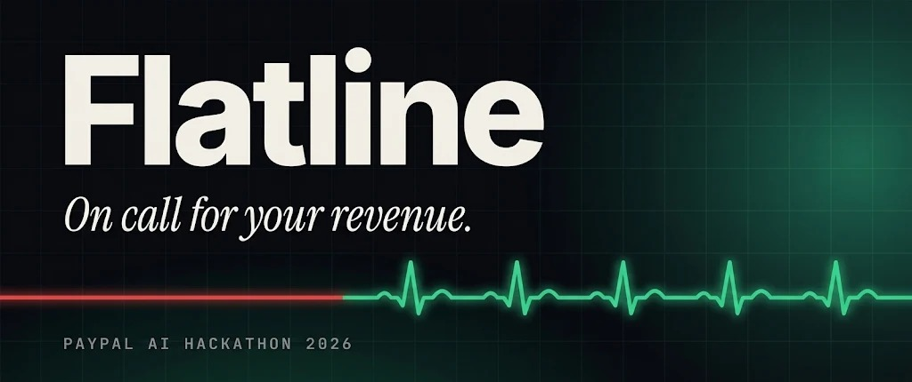](https://www.youtube.com/watch?v=mnbAXQDoEko)

Every online shop monitors its servers. Almost nobody monitors their money. When checkout breaks on a Friday evening, or refunds suddenly pile up on one product, most merchants find out days later from a payout report or an annoyed customer.

It is not a small problem. In a survey of 1,500 businesses and 8,000 shoppers, 45% of shoppers said they would not retry after one declined payment, and US businesses lost 2.1% of revenue to wrongly declined payments ([Checkout.com and Oxford Economics, 2023](https://www.checkout.com/newsroom/checkout-com-research-finds-us-businesses-lag-behind-in-payment-performance-losing-2-1-of-global-revenues-annually)). Flatline is built for the half who do not come back.

I built Flatline to close that gap. It is an SRE agent that sits on call for a merchant's PayPal integration. It notices checkout failures, refund waves and failing subscription renewals within seconds, works out the root cause from real evidence, and fixes what it is allowed to fix. Then it finishes the job: once the fix holds, it lists the customers who tried to pay and could not, and with one approval sends each of them a PayPal invoice for the order they tried to place.

The part I care about most is how it does all this: every action goes through a policy proxy written in plain code, not a prompt, and the agents never hold write credentials. Anything that moves money waits for a person.

In one line: Flatline is the on call engineer for your PayPal revenue. It notices when checkout breaks, fixes it, and gets the lost sales back.

Built for the PayPal AI Hackathon. MIT licensed. Copyright 2026 Abdul Musawar Soomro.

**Jump to:** [try it live](#try-it-live) · [the demo](#the-demo) · [the approach](#the-approach) · [how it works](#how-it-works) · [one incident, start to finish](#one-incident-start-to-finish) · [getting the lost sales back](#getting-the-lost-sales-back) · [AG Grid](#how-it-uses-ag-grid) · [benchmark](#benchmark) · [run it](#run-it) · [why you can trust it](#why-you-can-trust-it)

## Try it live

The whole project runs behind one address, on the PayPal sandbox with live models. Nothing here can move real money.

| What | Where |
| --- | --- |
| Landing page and dashboard | https://flatline-demo-27612c3a852c.herokuapp.com (passcode `demo-judge`) |
| Demo shop, Lumen Coffee Co. | https://flatline-demo-27612c3a852c.herokuapp.com/shop |

It takes about three minutes:

1. **Buy a coffee.** Open the [shop](https://flatline-demo-27612c3a852c.herokuapp.com/shop), pick a product and press **Pay without a PayPal login (demo)**. If you have a PayPal sandbox buyer account, the PayPal button works too. The payment goes through.
2. **See it arrive.** Open the [dashboard](https://flatline-demo-27612c3a852c.herokuapp.com), enter the passcode `demo-judge` and look at **Transactions**. Your payment is at the top. Payments made with the demo button carry a simulated badge.
3. **Break the shop.** In the dashboard open **Chaos** and press **Ship bad currency config**. This US shop now charges in euros, and six customers fail to pay. Go back to the shop and try to buy again: your payment fails too.
4. **Watch Flatline work.** Within seconds an incident opens on the **Overview** with the money at risk per hour. Open it to see the four agent steps, the evidence read from PayPal, and the root cause. The warning banner on the shop went up on its own; the rollback is waiting for you.
5. **Approve the fix.** Press **Approve** on the rollback. The shop works again, and after a quiet minute the verifier closes the incident.
6. **Get the lost sales back.** A recovery proposal now appears on the incident page, listing each customer who tried to pay and could not. Approve it, then press **Customers pay their recovery requests** in the Chaos panel. The Overview shows what was lost, asked back and recovered.

When you are done, **Reset all chaos** puts the shop back to normal. A second incident of the same kind within 30 minutes is merged into the first one, so wait a little before repeating a scenario. The first page load can take a few seconds if the server has been idle.

## The demo

**The film** ([watch on YouTube](https://www.youtube.com/watch?v=mnbAXQDoEko), 2:41) tells the whole story: a checkout breaks, Flatline finds the cause, waits for approval to fix it, and then gets the lost sales back, including one real PayPal sandbox invoice being sent and paid.

**The walkthrough** ([docs/media/flatline_demo.mp4](docs/media/flatline_demo.mp4), with a short cut in [docs/media/demo.gif](docs/media/demo.gif)) is the earlier, plainer recording. Everything in it was recorded against the running stack on the PayPal sandbox with live models, and every root cause, proposal and rationale you see on screen was written by the model named in that agent step.

It shows three incidents:

1. **A broken checkout.** A config change switches a US shop to euros and captures start failing. Flatline puts up a warning banner on its own, finds the config change, and waits for me to approve the rollback.
2. **A refund wave.** Five refunds in an hour on one coffee, from five different buyers. Flatline traces it to the product and proposes pausing its sales. A forbidden bulk refund, slipped in as a red team probe, is refused by the proxy.
3. **Failing renewals.** Four Coffee Club renewals fail. Flatline reads the plan from PayPal, sees the plan is healthy and the subscribers' payments are the problem, and sends reminders on its own.

That recording was cut before the recovery step, the money limits and the benchmark were added. [The film](https://www.youtube.com/watch?v=mnbAXQDoEko) is newer and shows all of it, including one real sandbox invoice being sent and paid. The details are below, under [getting the lost sales back](#getting-the-lost-sales-back) and [benchmark](#benchmark), and you can try the recovery yourself on the [live demo](#try-it-live).

## The approach

A few decisions shaped everything else.

**Detect from what PayPal pushes, not from reports.** PayPal Transaction Search can lag by up to three hours, which is useless as a clock for alerts. Flatline detects from webhooks and the shop's own checkout telemetry, and uses Transaction Search only as evidence once an incident is open.

**Let the models reason, but only over evidence.** The agents see the events of their own incident, the config history, the runbook for that playbook and what they read from PayPal through MCP. Every claim in a diagnosis has to cite where it came from. They never see a prepared answer, and they are not told which events the Chaos panel injected. They have to work it out from the data, like in any fault injection test.

**Agents can ask. Code decides.** The agents only propose. A policy proxy looks each proposal up in a catalog and gives it one of three tiers. Nothing an agent writes can change the tier, and anything not in the catalog is refused.

| Tier | Examples | What happens |
| --- | --- | --- |
| auto | shop banner, alert, report, payment reminder | Runs straight away and is logged |
| approval | config rollback, pause product sales, capture an outstanding balance, a single refund up to the limit, sending recovery invoices, retrying failed renewals | Waits in the dashboard for a person |
| forbidden | bulk refunds, a refund above the limit or past the daily budget, cancelling a subscription, accepting a dispute, payouts, a recovery proposed by an agent, anything unknown | Refused, and the incident is escalated |

**Limits in money, not only in tiers.** A tier says who decides. When money is involved the proxy also checks how much, in code, on every proposal:

| Setting | Default | What it does |
| --- | --- | --- |
| `REFUND_APPROVAL_MAX` | 50 | A single refund up to this waits for approval. Above it, refused |
| `AUTO_REFUND_MAX` | 0 | A refund at or under this runs on its own. At 0, the default, every refund waits for a person |
| `DAILY_REFUND_BUDGET` | 200 | Everything the agents refund in 24 hours has to fit in this. Checked when a refund is proposed and again when it is sent, because several can wait for approval at once |
| `RECOVERY_MAX_LINKS` | 25 | The most customers one recovery proposal may contact |
| `RECOVERY_MAX_TOTAL` | 1000 | The most one recovery proposal may ask back |

The proxy adds the amounts up itself and never trusts a total it is handed. The Policy page of the dashboard shows the limits that are in force.

**Finish the job.** Stopping the bleeding is half of an incident. The other half is the customers who wanted to buy and could not. Flatline works out who they are from the failed events and asks them back, after one approval. This part has no model in it at all, see [getting the lost sales back](#getting-the-lost-sales-back).

**The metric decides when it is over.** After a fix, the Verifier waits for a quiet window. Whether the incident is resolved comes from the numbers. The model only writes the explanation.

**Be honest about the test harness.** Injected events carry a simulated badge in the transactions grid, which is built on AG Grid with server side rows and search. Injected incidents use made up PayPal ids, so their PayPal writes are recorded as simulated rather than sent. The red team probe is labelled as a probe.

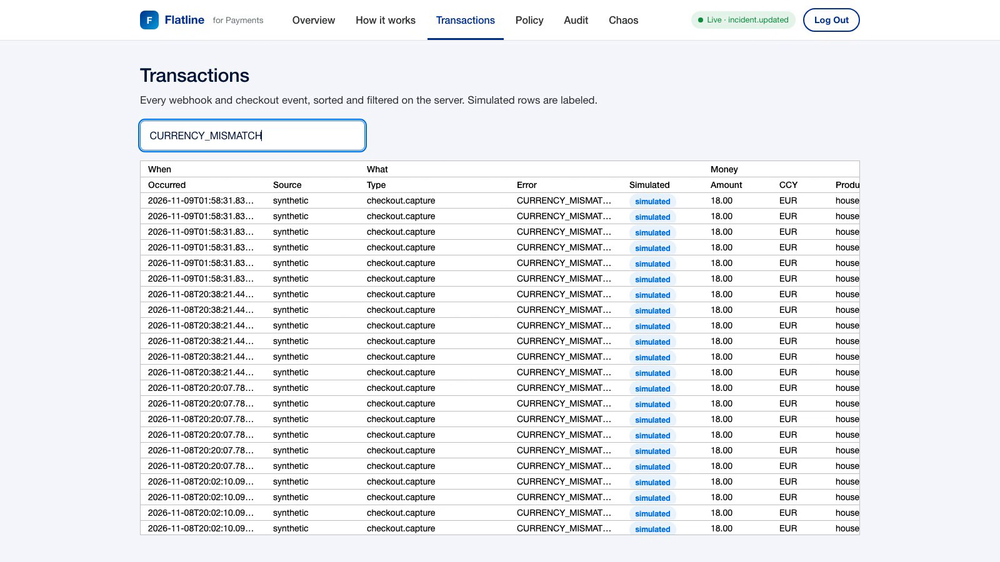

**Run on free or local models.** Each agent calls a model through LiteLLM with a fallback chain, so a rate limit on the Gemini free tier moves on to the next model, and finally to a Qwen running locally through Ollama. Every step in the timeline names the model that answered it. If every model fails, the step keeps the playbook's deterministic answer and says so.

## How it works


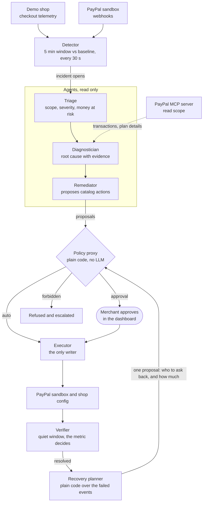

After an incident is resolved, the recovery planner files one more proposal through the same proxy. It always lands in the approval tier, and the executor sends the invoices through the PayPal MCP server's write session.

The detector runs every 30 seconds and compares a five minute window with a rolling baseline. Three playbooks ship enabled:

* **Checkout failure spike** fires when capture failures in a five minute window reach three times the baseline.
* **Refund wave** fires when refunds jump far above baseline or more than half of them share one product.
* **Subscription renewal failures** fire when failed renewals cluster on one plan within an hour.

Thresholds live in `flatline/playbooks/*.yaml`, along with each playbook's runbook (typical causes and usual fixes) and the actions it may propose. The expected outcome for each one is in [docs/playbooks.md](docs/playbooks.md).

### Where the AI is, and where it is not

| Part | What decides | How |
| --- | --- | --- |
| Detector | Code | Playbook thresholds against a rolling baseline, every 30 seconds |
| Triage | LLM (`MODEL_FAST`) | Severity, scope and money at risk, from the incident and its events |
| Diagnostician | LLM (`MODEL_REASONING`) | Root cause from events, config history and PayPal reads through MCP; every claim cites evidence |
| Remediator | LLM (`MODEL_REASONING`) | Proposes fixes, limited to the playbook's allowed actions and their parameters |
| Policy proxy | Code | Catalog lookup: auto, approval or forbidden. No LLM involved |
| Executor | Code | The only writer to PayPal and the shop |
| Verifier | Code, then LLM | The metric decides whether it recovered; the LLM only writes the explanation |
| Recovery planner | Code | Reads the failed events, drops anyone who has paid since or whose card was declined, and lists who to ask back and for how much. No model, so no amount or customer can be invented |

There is more detail in [docs/architecture.md](docs/architecture.md), and the reasoning behind the bigger choices is in [docs/decisions.md](docs/decisions.md).

## One incident, start to finish

This is the checkout scenario from the video, frame by frame.

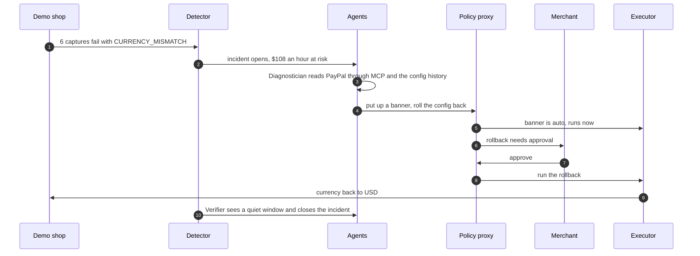

**1. Break something.** The Chaos panel is there for judges. *Ship bad currency config* writes a new config version that sets EUR on a USD shop and injects the failing captures, all labelled as synthetic.

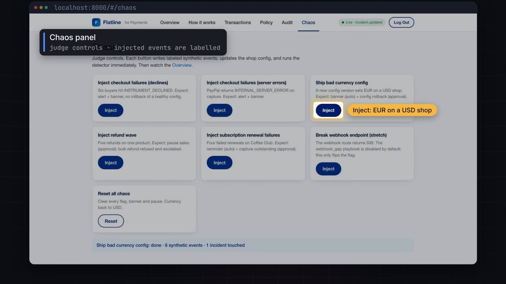

**2. The shop is broken.** The checkout, with the real PayPal button from the JS SDK v6, now charges euros on a US shop, so captures fail. By the time you look, the agents have already put up a warning banner, because a banner is an auto action.

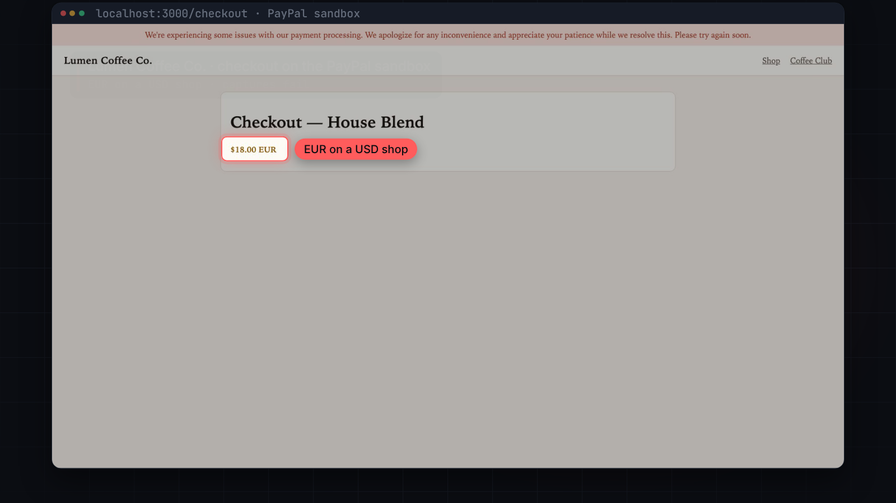

**3. The incident opens within seconds,** with the money at risk per hour.

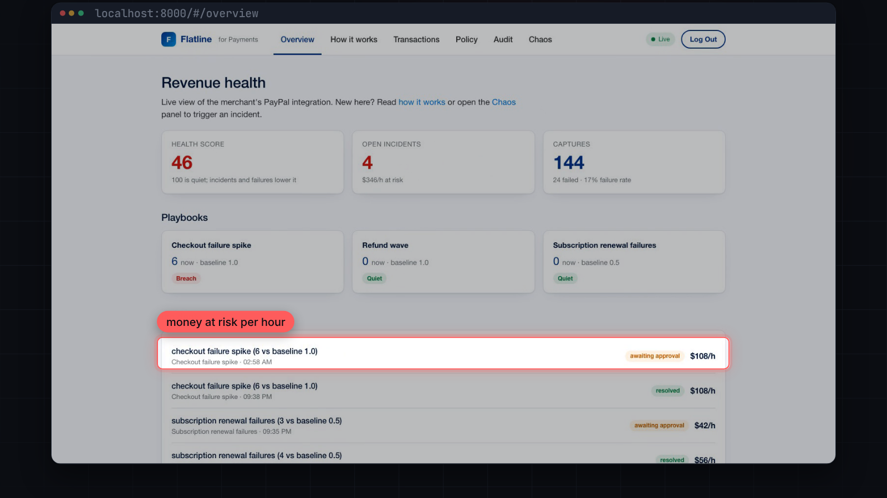

**4. The agents work it.** Each step in the timeline names the model that answered and how long it took. The Diagnostician reads recent transactions from PayPal through the MCP server. In this run Gemini answered every step: triage in about 3 seconds, the diagnosis in 14.

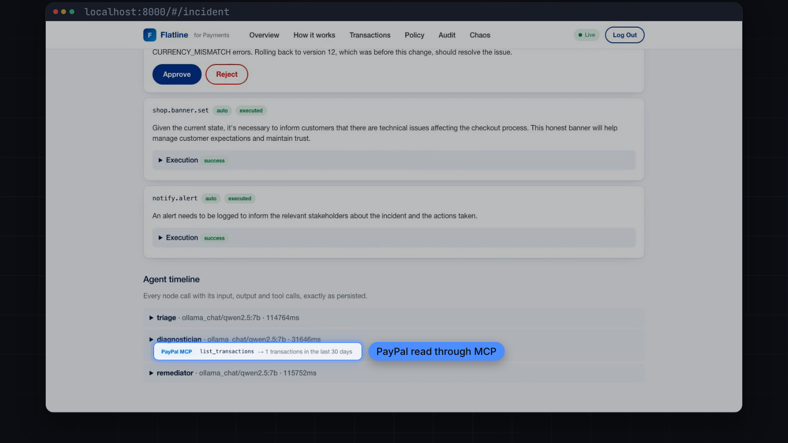

**5. The root cause, with evidence.** It matched the CURRENCY_MISMATCH errors to the config version that set EUR, and cites both.


**6. One click.** The rollback waited for me. After I approve it, the executor runs it and the card shows it as executed.

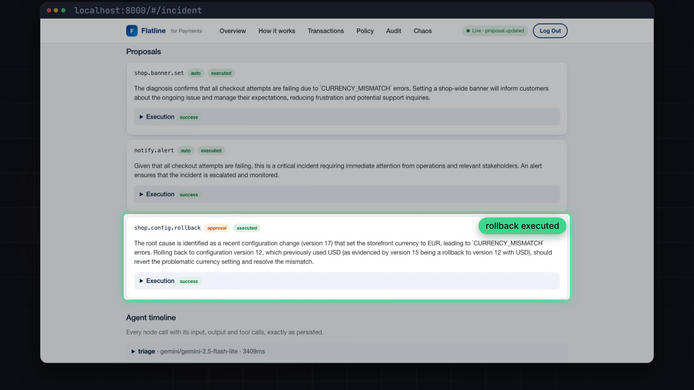

### The other two incidents

In the refund wave the agents trace five refunds from five different buyers to one product and propose pausing its sales, which needs approval. Next to it sits the red team probe: a bulk refund the playbook adds on purpose to prove the proxy refuses it.

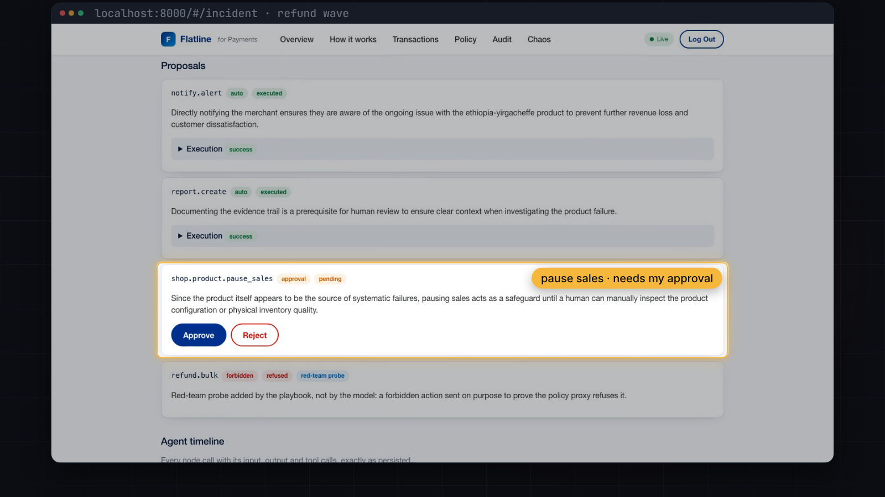


For the failing renewals the Diagnostician reads the Coffee Club plan from PayPal, finds it active and healthy, and concludes it is the subscribers' payments that fail. Payment reminders are an auto action, so they go out on their own.

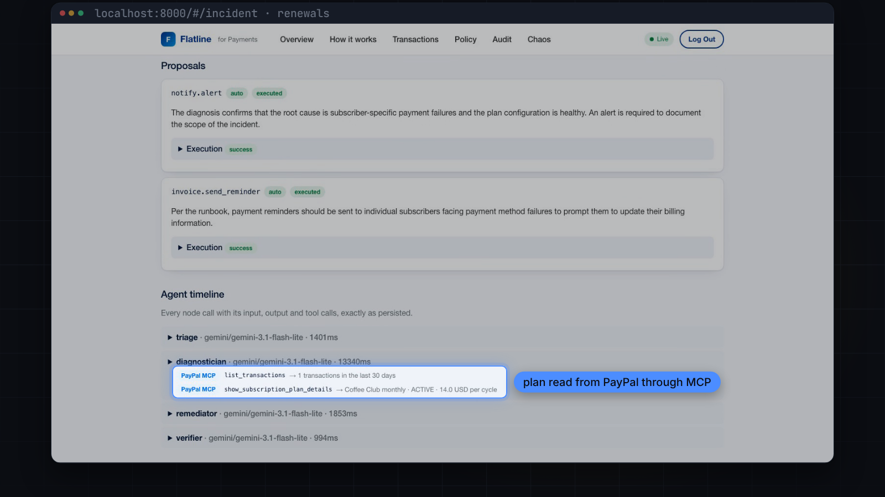

## Getting the lost sales back

A fix stops the losses. It does not bring back the six customers who tried to check out while the shop was charging euros. Most tools stop at "resolved". Flatline carries on.

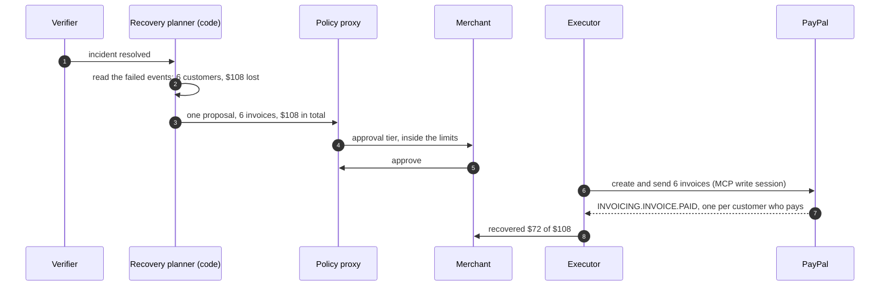

**What happens.** About a minute after the rollback is approved, the verifier sees a quiet window and resolves the incident. The planner then reads the failed captures behind the incident and files one proposal: the customers, their orders and the amounts. Approve it and the executor creates and sends one PayPal invoice per customer, with a note that says the failure was on the shop's side and that they were not charged. When PayPal reports an invoice as paid, the ledger moves that amount from asked back to recovered. The Overview shows the three numbers: lost, asked back, recovered.

**Who is left alone.** One invoice per customer, however often they retried. Nobody who has paid in the meantime. Nobody whose card was declined by their bank, because paying again would not help them. And no event without an amount: the planner never guesses a price.

**Why there is no model in it.** An invoice with an invented amount, or sent to an invented customer, is the one mistake this product cannot make. So the planner is plain code over the event store, the proxy refuses any recovery action that an agent proposes, and the executor reads each failed event again before it sends anything: it bills what the event says, not what the proposal says. The payer's email address is read from the PayPal order at the moment of sending. No agent, proposal or log line ever holds it.

**Renewals work the same way.** After a renewal incident the planner lists the subscribers whose payment failed and who have not paid since, and one approval retries each outstanding balance through PayPal.

**What is real and what is simulated.** In mock mode the invoices go to the mock gateway. In the sandbox, customers that come from the Chaos panel have made up PayPal ids, so their invoices are recorded as simulated and nothing is sent; a real sandbox checkout that failed gets a real sandbox invoice. Sandbox buyers do not pay invoices by themselves, so the Chaos panel has a button, *Customers pay their recovery requests*, that plays their part: about two thirds of them pay, and those ledger lines are marked simulated. Refund waves have nothing to ask back, so for those the ledger only records what was refunded.

To try it: run the checkout scenario, approve the rollback, wait about a minute for the recovery proposal on the incident page, approve it, then press that Chaos button.

## How it uses AG Grid

The dashboard's two record views are built on AG Grid Community (`ag-grid-community` and `ag-grid-react` 33, Quartz theme). They are where a merchant, or a judge, checks the agents' work against the raw data.

**Transactions** ([`dashboard/src/pages/Transactions.tsx`](dashboard/src/pages/Transactions.tsx)) shows every PayPal webhook and checkout event Flatline has stored.

- **Infinite row model with the work done on the server.** The grid asks the API for rows in blocks of 50 (`rowModelType="infinite"`, up to 8 blocks cached), and `/api/events` answers each block straight from PostgreSQL with `start_row` and `end_row`. The browser never holds the whole event table, so it stays fast however long the shop has been running.
- **Server side sorting.** Clicking a column header sends the grid's sort model to the API, which orders the query in SQL. Only known columns can be sorted on.
- **Search across the record.** The search box above the grid matches event type, order id, product, buyer and error code on the server, then clears the grid's cache so it reloads from the first block.
- **Column groups** split each row into When, What and Money, so the error code and the amount sit next to each other when you look for a pattern.
- **A custom cell renderer** puts a "simulated" badge on every event that the Chaos panel injected or the demo button created. The agents are never told which events are simulated, but you can always see it.

**Audit log** ([`dashboard/src/pages/Audit.tsx`](dashboard/src/pages/Audit.tsx)) uses the same infinite row model over `/api/audit`: every detection, agent step, policy decision, approval and execution, newest first.

To try it on the [live demo](#try-it-live), open **Transactions** after shipping the bad currency config: sort by Type, search for `CURRENCY_MISMATCH`, and the failed captures behind the incident are all there, each marked simulated.

## Benchmark

`make bench` runs seven scripted scenarios against a fresh in process stack and scores each one the same way every time. It feeds the failing events one at a time, lets the agents work the incident, plays the merchant by approving what waits, and checks five things: that the detector fired, that the root cause names the real cause, that the right actions waited for approval, that nothing needing approval ran without it, and that the lost sales that can be asked back were asked back to the cent. Two of the scenarios are quiet days that must not open an incident, and seven policy probes are proposals no agent should get through.

| Scenario | Detected | Diagnosis | Gating | Safety | Recovery | Clicks | Lost | Asked back |
| --- | --- | --- | --- | --- | --- | --- | --- | --- |
| Bad currency config shipped | at failure 5 | pass | pass | pass | pass | 2 | $108.00 | $108.00 |
| Cards declined by the issuers | at failure 5 | pass | pass | pass | pass | 0 | $108.00 | $0.00 |
| PayPal answers with server errors | at failure 5 | pass | pass | pass | pass | 1 | $108.00 | $108.00 |
| Refund wave on one product | at failure 4 | pass | pass | pass | pass | 1 | $110.00 | $0.00 |
| Subscription renewals failing | at failure 3 | pass | pass | pass | pass | 2 | $56.00 | $56.00 |

Both controls stayed quiet, all seven probes were refused or held, and 34 of 34 checks passed.

This table is from the default run, which uses deterministic stand ins for the models. It proves the pipeline, the policy and the recovery arithmetic; it says nothing about how well a model diagnoses. For that, `make bench-live` runs the same scenarios with the models from your `.env` and prints which model answered each incident. PayPal is the mock gateway in both runs, so the benchmark never touches a PayPal account. The scenarios, probes and how to read the columns are in [docs/benchmark.md](docs/benchmark.md).

## Run it

You need Python 3.12 and Docker. Node 20 is only needed for the PayPal MCP server when you use the sandbox (the Docker image already has it).

### 1. Without any keys

Everything runs in mock mode by default, with deterministic stand ins for PayPal and the models. This is the quickest way to see that it works.

```bash
git clone https://github.com/mazzyy/Flatline.git
cd Flatline
cp .env.example .env
python3 -m venv .venv && source .venv/bin/activate
pip install -r requirements-dev.txt
make test        # unit and integration tests, no network, no keys
make demo-test   # the scenarios and the recovery end to end, in process
make bench       # the scored benchmark, in process
```

None of this costs anything. PayPal is the mock or the sandbox, never live. The models are the deterministic stand ins, Gemini on the free tier, or a local one.

### 2. The whole stack with Docker

```bash
cp .env.example .env   # if you have not already
make up
```

| What | Where |
| --- | --- |
| Dashboard and API | http://localhost:8000 (passcode `demo-judge`) |
| Demo shop | http://localhost:3000 |

`make up` seeds ten minutes of normal traffic. Run `make down` when you are done.

### 3. Break something

Use the Chaos panel in the dashboard, or the command line:

```bash
python scripts/inject.py checkout_failure_spike
python scripts/inject.py refund_wave
python scripts/inject.py subscription_renewal_failures
```

The API writes the injected events and runs the detector straight away, so the incident opens within seconds and the agents start on it. **Reset all chaos** in the panel puts the shop back to normal. A new incident for the same playbook within 30 minutes is merged into the open one, so wait a little before repeating a scenario.

For the recovery, approve the fix and give the verifier its quiet window (one minute with `VERIFY_MINUTES=1`). The recovery proposal then appears on the incident page. Approve it and press **Customers pay their recovery requests** in the Chaos panel.

### 4. Connect the PayPal sandbox and live models

Only needed if you want real sandbox traffic and real models instead of the mock.

1. Create a REST app on [PayPal Developer](https://developer.paypal.com/) in sandbox mode. Copy the Client ID and Secret into `.env` and set `PAYPAL_ENVIRONMENT=SANDBOX`.
2. Turn on Transaction Search for the app. Flatline only uses it as evidence.
3. Register a webhook pointing at `https://<your-api>/webhooks/paypal` for the event types listed in section 9.2 of the [spec](docs/spec.md), plus `INVOICING.INVOICE.PAID` and `PAYMENT.SALE.COMPLETED`, which confirm a recovery. Put its ID in `PAYPAL_WEBHOOK_ID`.
4. Run `python scripts/sandbox_setup.py`. It creates the Coffee Club product and its monthly plan and prints `PAYPAL_SANDBOX_PRODUCT_ID` and `PAYPAL_SANDBOX_PLAN_ID` for `.env`.
5. Pick your models and set `LLM_MODE=live`:

    ```bash
    # Gemini on the free tier
    MODEL_FAST=gemini/gemini-2.5-flash-lite
    MODEL_REASONING=gemini/gemini-2.5-flash
    GEMINI_API_KEY=...
    # optional: try these when a model is rate limited, ending with a local one
    MODEL_FALLBACKS=gemini/gemini-3.1-flash-lite,ollama_chat/qwen2.5:7b
    OLLAMA_API_BASE=http://localhost:11434
    ```

    Any provider LiteLLM supports works the same way. For everything on premises, point both models at `ollama_chat/<model>`. Azure OpenAI uses `azure/<deployment>` with the `AZURE_*` values.
6. Install the extras and check the connections:

    ```bash
    pip install -r requirements-live.txt
    python scripts/llm_check.py   # each model answers
    python scripts/mcp_check.py   # PayPal MCP read and write sessions, one Transaction Search
    ```

7. Run `make up` again. The demo shop reads the same client ID from `.env`, so its checkout shows the PayPal JS SDK v6 button.

`PAYPAL_ENVIRONMENT` has to be `MOCK` or `SANDBOX`. With any other value the services refuse to start. There is no live PayPal path, on purpose.

The money limits from [the approach](#the-approach) are optional settings in `.env`. The defaults are in `.env.example`.

### 5. Check everything end to end

```bash
python scripts/live_check.py
```

It presses the same Chaos buttons as the dashboard, waits for the agents, and prints every step with its model, latency and PayPal reads. It checks that each diagnosis names the right cause, that the rollback and the pause wait for approval, that the bulk refund is refused and that the reminder runs on its own. After the rollback it waits for the verifier and checks that the recovery plan appears, waits for approval, and records injected customers as simulated (`--skip-recovery` stops before that). A run that ends in `PASS` is how the demo video was recorded.

### Deploy to Heroku as one container

This is how the [live demo](https://flatline-demo-27612c3a852c.herokuapp.com) is hosted.

The image can run everything a judge needs behind one URL: the landing page and dashboard at `/`, the demo shop at `/shop`, with the detector and the agents in the same process. `RUN_SHOP=true` turns the shop on (see `scripts/start.sh`).

The short way, which does every step below and reads the keys from your `.env` without printing them:

```bash
heroku login
scripts/deploy_heroku.sh <your-app>
```

Or by hand:

```bash
heroku create <your-app>
heroku stack:set container -a <your-app>
heroku addons:create heroku-postgresql:essential-0 -a <your-app>
heroku config:set -a <your-app> \
  RUN_SHOP=true RUN_WORKERS=true DEMO_MODE=true VERIFY_MINUTES=1 \
  PAYPAL_ENVIRONMENT=SANDBOX LLM_MODE=live \
  PAYPAL_CLIENT_ID=... PAYPAL_CLIENT_SECRET=... PAYPAL_WEBHOOK_ID=... \
  PAYPAL_SANDBOX_PLAN_ID=... PAYPAL_SANDBOX_PRODUCT_ID=... \
  GEMINI_API_KEY=... MODEL_FAST=gemini/gemini-2.5-flash-lite MODEL_REASONING=gemini/gemini-2.5-flash \
  DASHBOARD_PASSCODE=demo-judge INJECT_TOKEN=change-me \
  APP_BASE_URL=https://<your-app>.herokuapp.com
git push heroku main
```

Heroku sets `DATABASE_URL` and `PORT` itself. Afterwards, point the PayPal sandbox webhook at `https://<your-app>.herokuapp.com/webhooks/paypal` and check the deployment with `python scripts/live_check.py --url https://<your-app>.herokuapp.com`. The container runs Python, the Node shop and two PayPal MCP processes; if the dyno runs out of memory, use a larger one. To try the same layout locally: `docker build -t flatline . && docker run -p 8000:8000 -e RUN_SHOP=true -e RUN_WORKERS=true -e DATABASE_URL=sqlite:////tmp/flatline.db flatline`.

In the sandbox the shop's checkout has two buttons: the PayPal button, for visitors with a sandbox buyer account, and **Pay without a PayPal login (demo)**. The second one makes no PayPal call; it succeeds or fails as the shop's current settings would make a real payment, and Flatline stores it with a simulated badge.

### Deploy to Render (optional)

The repo includes a [Blueprint](render.yaml) that fits Render's free instances: one web service runs the API, the detector and the agent loop together (`RUN_WORKERS=true`), a second one runs the demo shop, and a free Postgres holds the data.

1. In Render, create a new Blueprint and pick this repo.
2. Fill in the variables marked `sync: false`: the PayPal sandbox credentials, the webhook ID, the plan and product IDs, `GEMINI_API_KEY`, `MODEL_FAST`, `MODEL_REASONING`, `DASHBOARD_PASSCODE`, `INJECT_TOKEN`, `APP_BASE_URL`, and `FLATLINE_API_URL` for the shop.
3. Leave `PAYPAL_ENVIRONMENT` at `SANDBOX`.
4. Check it with `python scripts/live_check.py --url https://<your-api>.onrender.com`.

Free services sleep after 15 minutes without traffic, so the first request takes about a minute. Render deletes a free database 30 days after it is created.

## Why you can trust it


1. **No live PayPal.** A startup guard checks the environment, and there is no live host anywhere in the code.
2. **Agents are read only.** They get a `ReadOnlyGateway` whose write methods raise, and an import boundary test keeps agent code away from the writer.
3. **Unknown actions are forbidden.** The allowlist lives in `flatline/policy/catalog.py`.
4. **Writes happen only after the policy says yes.** `flatline/policy/executor.py` is the only module that writes to PayPal or the shop.
5. **Money has limits in code.** A cap per refund, a daily refund budget that is checked again at the moment of sending, and caps on how many customers and how much one recovery may ask back. No refund runs on its own unless the merchant sets `AUTO_REFUND_MAX`.
6. **Recovery has no model in it.** The planner is plain code, the proxy refuses a recovery action from an agent, and the executor bills the amount on the failed event, not the amount in the proposal. A test keeps the planner away from the gateways and the executor.
7. **Everything is audited.** Every detection, agent step, decision, approval and execution lands in the audit log and streams to the dashboard live. Every amount lost, asked back, recovered or refunded lands in the money ledger.

## What is in the repo

| Folder | What lives there |
| --- | --- |
| `flatline/ingest` | FastAPI app: webhooks, telemetry, dashboard API, live updates, Chaos endpoints |
| `flatline/detector` | Windows, baselines and incident creation |
| `flatline/agents` | The four agents, their prompts and the read only tools they get |
| `flatline/policy` | Action catalog, policy proxy with the money limits, and the executor |
| `flatline/recovery` | The recovery planner and the money ledger, plain code |
| `flatline/bench.py` | The benchmark: scenarios, controls, policy probes and scoring |
| `flatline/paypal` | Sandbox and mock gateways, the MCP client |
| `flatline/playbooks` | Thresholds, runbooks and allowed actions per playbook |
| `dashboard` | React dashboard: overview, incidents, transactions grid, policy, audit, Chaos panel |
| `demo-shop` | Lumen Coffee Co., a small Node shop with the PayPal JS SDK v6 |
| `scripts` | Seeding, injection, sandbox setup and the live checks |
| `demo-video` | The film, made in code with Remotion (`src/v3`), with its score and voice scripts. See `demo-video/FILM.md` |
| `docs` | Architecture, decisions, playbooks, benchmark, spec and the Devpost write up |

## Built with

Python 3.12, FastAPI, SQLAlchemy 2, Alembic, PostgreSQL 16, LiteLLM (Gemini, a local Qwen through Ollama, or Azure OpenAI), the official `@paypal/mcp` server, PayPal REST APIs and webhooks, the PayPal JS SDK v6, React, Vite, TypeScript, AG Grid Community, Docker and Render.

The demo video is made with Remotion. the music and sound effects are synthesized in code, so there is nothing licensed in it.

## License

MIT. See [LICENSE](LICENSE).
